  

  <a href="https://www.linkedin.com/in/rohit-kumar-pulamarasetty"><strong>LinkedIn</strong></a>
  &nbsp;·&nbsp;
  <a href="https://kaggle.com/rohitpulamarasetty"><strong>Kaggle</strong></a>
  &nbsp;·&nbsp;
  <a href="https://rohitpulamarasetty.github.io/"><strong>Portfolio</strong></a>

I’m studying Data Science and Applications at **IIT Madras** and building software through **Beyond Binary Solutions**. I’m curious about which signals still hold up when you test them on data the model has never seen.

## Research interests

- **Quantitative research** — market data, time-series signals, and backtests that account for transaction costs.
- **Machine learning** — feature engineering, simple baselines, and evaluating models on future periods without leaking information.

  

## Selected work

| Project | What I built |
| --- | --- |
| [Aadhaar Data Analysis](https://github.com/RohitPulamarasetty/Aadhaar-Data-Analysis) | Cleaned public enrolment and update data, engineered stress metrics, and mapped regional gaps in Tableau. |
| [Retail Sales Analysis](https://github.com/RohitPulamarasetty/Retail-Sales-Analysis) | Used SQL and Tableau to trace where discounts and order mix eroded margins. |
| [IITM Grade Suite](https://github.com/RohitPulamarasetty/iitm-grade-suite) | Built a grade tracker and a target-score planner for IIT Madras BS students. |

**Tools I use** · Python · SQL · Tableau · Git
