  

  
  
  
  
  
  

I’m studying Data Science and Applications at **IIT Madras** and building software through **Beyond Binary Solutions**. I’m curious about which signals still hold up when you test them on data the model has never seen.

## Research interests

- **Quantitative research** — market data, time-series signals, and backtests that account for transaction costs.
- **Machine learning** — feature engineering, simple baselines, and evaluating models on future periods without leaking information.

  

## Featured projects

  

A tiny macOS companion with 36 personalities, recurring reminders, and a Pomodoro timer. Tasks and history stay on your Mac.

**[Get it for Mac](https://github.com/RohitPulamarasetty/desktop-companion-macos/releases)** · [Source code](https://github.com/RohitPulamarasetty/desktop-companion-macos)

  

A grade calculator, end-term predictor, and CGPA tracker for IIT Madras BS students.

**[Open Grade Suite](https://iitm-grade-suite.pages.dev/)** · [Source code](https://github.com/RohitPulamarasetty/iitm-grade-suite)

## Skills

  <a name="skills-row-1">
    <picture>
      <source media="(max-width: 640px)" srcset="./assets/skills-row-1-mobile.svg" />
      
    </picture>
  </a>

  <a name="skills-row-2">
    <picture>
      <source media="(max-width: 640px)" srcset="./assets/skills-row-2-mobile.svg" />
      
    </picture>
  </a>

  <a name="skills-row-3">
    <picture>
      <source media="(max-width: 640px)" srcset="./assets/skills-row-3-mobile.svg" />
      
    </picture>
  </a>

